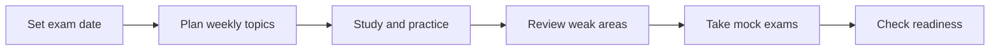

## Overview

A clear study plan helps you stay consistent, measure progress, and reduce last-minute pressure before exam day. This starter kit page gives you a generic structure you can adapt to any certification, licensure, or admissions exam.

You will see a simple workflow for planning your timeline, building a daily routine, running mock exams, and checking readiness as the test date approaches. Replace the examples with your own subject list, target score, and calendar.

<Callout kind="info">
This is a starter kit template. Customize the timelines, subject weights, and practice cadence to match your exam, available study time, and current skill level.
</Callout>

## Build Your Study Timeline

Start by working backward from your exam date. Break the full preparation window into phases so you know what to study first and when to shift from learning to review. A practical structure is:

- Foundation phase for core concepts
- Practice phase for timed questions and recall
- Review phase for weak areas and full-length simulations

<Columns cols={3}>
  <Card title="Foundation" icon="book-open" href="#foundation-phase">
    Learn the core topics, terminology, and high-yield concepts first.
  </Card>
  <Card title="Practice" icon="zap" href="#practice-phase">
    Build speed and accuracy with timed question sets and mixed topics.
  </Card>
  <Card title="Review" icon="shield" href="#review-phase">
    Close gaps with revision cycles, error logs, and short recall sessions.
  </Card>
</Columns>

### Example Timeline

| Time Before Exam | Focus | Outcome |
|---|---|---|
| 12 to 8 weeks | Core study | You finish the first pass through the syllabus |
| 8 to 4 weeks | Timed practice | You improve accuracy and pacing |
| 4 to 2 weeks | Mock exams | You identify weak areas under exam conditions |
| Final 2 weeks | Revision | You stabilize performance and reduce mistakes |

## Daily and Weekly Routine

Consistency matters more than occasional long sessions. Use a repeatable routine that you can sustain across the full preparation period. Keep each study block focused, and separate learning time from testing time.

<Steps>
  <Step title="Set a daily target" icon="target">
    Choose a realistic time block, such as 60 to 120 minutes, and assign one main topic to each session.
  </Step>
  <Step title="Study actively" icon="book-open">
    Read, take notes, answer recall questions, and explain concepts in your own words instead of only rereading material.
  </Step>
  <Step title="End with recall" icon="check-circle">
    Finish each session with quick questions, flashcards, or a short summary to strengthen memory.
  </Step>
  <Step title="Review weekly" icon="calendar">
    Reserve one longer session each week for mixed practice, error review, and planning the next week.
  </Step>
</Steps>

### Sample Weekly Schedule

Use this example as a template and adjust it for work, classes, or family responsibilities.

| Day | Main Activity | Time |
|---|---|---|
| Monday | Topic study and notes | 90 minutes |
| Tuesday | Practice questions | 75 minutes |
| Wednesday | Weak-area review | 60 minutes |
| Thursday | Topic study and recall | 90 minutes |
| Friday | Mixed quiz | 60 minutes |
| Saturday | Mock test or long review session | 2 hours |
| Sunday | Light revision and planning | 30 minutes |

## Practice Tests and Mock Exams

Practice tests help you measure readiness, but they work best when you review them carefully. Do not treat a mock exam as only a score. Use it as a diagnostic tool that shows you where you lose marks and why.

<Tabs>
  <Tab title="Early Practice" icon="zap">
    
Use short timed sets to build familiarity with question style. At this stage, focus on understanding explanations and spotting patterns in mistakes.

  </Tab>
  <Tab title="Mid-Phase Mock" icon="clock">
    
Take longer mixed sets under timed conditions. Track pacing, question accuracy, and topics that consistently need more review.

  </Tab>
  <Tab title="Final Simulation" icon="check-circle">
    
Run a full-length mock exam in a quiet environment that matches your test-day routine. Practice breaks, timing, and review discipline.

  </Tab>
</Tabs>

### A Simple Test Review Method

1. Mark each missed question by topic.
2. Write one sentence explaining the error.
3. Classify the issue as concept gap, careless mistake, or timing problem.
4. Revisit the topic within 48 hours.
5. Retest the same area later in the week.

<CodeGroup tabs="Spreadsheet,JSON">
  ```csv
Date,Topic,Result,Error Type,Next Review
2026-03-01,Pharmacology,Missed,Concept gap,2026-03-03
2026-03-02,Calculations,Missed,Careless mistake,2026-03-04
2026-03-04,Pharmacology,Correct,Improved,2026-03-07
  ```
  ```json
{
  "examDate": "2026-05-15",
  "mockScores": [
    {
      "date": "2026-03-01",
      "score": 68,
      "topic": "Pharmacology"
    },
    {
      "date": "2026-03-15",
      "score": 74,
      "topic": "Mixed Review"
    }
  ]
}
  ```
</CodeGroup>

## Revision and Weak-Area Review

Revision works best when it is frequent, short, and targeted. Instead of rereading everything, focus on what you still miss. That means using an error log, short notes, and repeated recall.

<Callout kind="tip">
Aim for short revision cycles every few days. Repeated exposure helps you retain difficult material better than one long review session at the end.
</Callout>

### What to Review First

Prioritize the topics that meet one or more of these conditions:

- You miss them repeatedly in quizzes
- They take too long to answer
- They appear often in practice tests
- They connect to multiple other topics

### Weak-Area Checklist

| Checkpoint | What You Should Confirm |
|---|---|
| Concept understanding | You can explain the topic without notes |
| Question accuracy | You answer basic and mixed questions correctly |
| Timing | You can solve questions at a steady pace |
| Recall | You remember formulas, steps, or definitions quickly |
| Confidence | You no longer avoid the topic in practice |

## Exam Readiness Checkpoints

Use checkpoints to decide whether you are ready to move forward. A readiness check should combine score trends, pacing, and confidence, not just one mock test result. If your practice is still unstable, stay in review mode a little longer.

<Expandable title="Signs you are ready" default-open="true">
  
You are likely ready when your practice scores are steady, you finish on time, and your weak areas are shrinking. You should also feel comfortable with the exam format and instructions.

</Expandable>

<Expandable title="Signs you need more review" default-open="false">
  
You need more preparation if you keep making the same mistakes, panic under timed pressure, or depend on memorized answers without understanding the topic.

</Expandable>

<Expandable title="How to adjust your plan" default-open="false">
  
If progress slows down, reduce new content and increase review time. If timing is the problem, add shorter timed sets. If accuracy is the problem, slow down and revisit fundamentals.

</Expandable>

## Suggested Preparation Workflow

Use this simple roadmap to keep your study plan organized from start to finish.



## Quick Planning Template

Copy this template into your notes and customize it for your own schedule.

```markdown
Exam date: 2026-05-15
Target study hours per week: 10
Main focus this week: Core topics
Practice test date: 2026-04-20
Weak areas to review: Calculations, terminology, timed reading
Readiness goal: Two stable mock scores above target range
```

## Next Steps

Choose one timeline, one daily routine, and one weekly review rhythm before you begin. Keep the plan simple enough that you can follow it consistently, then refine it as you learn more about your own strengths and weak areas.

If you want a stronger structure, start with a calendar view, add a question log, and schedule your mock exams in advance. That way, your preparation stays visible and measurable from the first week to the final review.