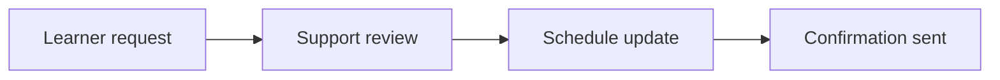

## Overview

This starter-kit page helps you troubleshoot consultation, enrollment, access, and scheduling issues for ASGHCA. Use it as a template for learner support so you can route common questions quickly and keep response handling consistent.

If you need to customize this page, replace the sample contact details, service hours, and support workflow with your own processes. The examples below show a practical structure you can adapt without changing the overall page layout.

<Callout kind="info">
  This is a starter kit template. Adjust the contact channels, turnaround times, and enrollment steps to match your own support process.
</Callout>

## Common Support Areas

<Columns cols={3}>
  <Card title="Free Consultation" icon="users" href="#consultation-process">
    Explain how learners request guidance and what they should prepare before the call.
  </Card>
  <Card title="Enrollment Help" icon="shield" href="#payment-and-enrollment">
    Cover payment confirmation, registration errors, and incomplete sign-up flows.
  </Card>
  <Card title="Course Access" icon="book-open" href="#access-and-scheduling">
    Help learners regain access to course materials and adjust their schedule.
  </Card>
</Columns>

## Consultation Process

A clear consultation process reduces back-and-forth and helps learners know what happens next. You can support a simple flow: request, review, booking, and follow-up.

<Steps>
  <Step title="Submit a request" icon="download">
    Ask learners to share their name, program of interest, preferred contact number, and any exam target date.
  </Step>
  <Step title="Confirm eligibility" icon="check-circle">
    Review the request and confirm whether the learner is a good fit for the selected course or consultation.
  </Step>
  <Step title="Schedule the session" icon="calendar">
    Share a time slot by email, phone, or messaging channel and note the expected session length.
  </Step>
  <Step title="Send the follow-up" icon="send">
    Summarize the discussion, next steps, and any documents the learner should prepare before enrollment.
  </Step>
</Steps>

<CodeGroup tabs="Email,WhatsApp">
  ```text
Subject: Consultation Request Received

Hello,

Thank you for contacting ASGHCA support. We have received your consultation request for the course you selected.

Please reply with:
- Your full name
- Your target exam or course name
- Your preferred contact number
- Your available time window

We will confirm the next available consultation slot shortly.

Best regards,
ASGHCA Support Team
```

  ```text
Hello, thank you for reaching out to ASGHCA support.

Please share:
- Your full name
- Your selected course
- Your preferred time for a consultation
- Any deadline or rescheduling note

We will review your request and reply with the next available option.
```
</CodeGroup>

## Payment and Enrollment

Use this section to explain what learners should do when payment does not reflect, enrollment is incomplete, or confirmation is delayed. Keep the instructions short and clear so support staff can follow them consistently.

| Situation | What you should check | Suggested next step |
| --- | --- | --- |
| Payment not reflected | Transaction status, time of payment, and payment reference | Ask the learner to resend proof of payment |
| Enrollment incomplete | Registration form fields and email confirmation | Verify the learner details and complete the record |
| Duplicate submission | Same email or phone number used twice | Merge the record and confirm the active enrollment |
| Wrong course selected | Course name and payment receipt | Pause activation until the learner confirms the correct course |

<Tabs>
  <Tab title="Bank Transfer" icon="database">
    Ask the learner to attach the transfer receipt, sender name, date, and transaction reference. If the payment is still pending after verification, escalate it to finance for manual review.
  </Tab>
  <Tab title="Card Payment" icon="credit-card">
    Confirm whether the payment was authorized and completed successfully. If the learner sees a failed checkout page, ask them to retry once and then share the error message.
  </Tab>
  <Tab title="Manual Review" icon="settings">
    Use manual review when the payment is delayed, the receipt is unclear, or the learner paid from a different account name.
  </Tab>
</Tabs>

## Course Access and Scheduling

When learners cannot open a lesson or need a schedule change, start with the basics: account email, course assignment, and the most recent activity date. Many access issues resolve after you verify the correct account and enrollment record.

<Callout kind="tip">
  Encourage learners to keep a screenshot of any error message. This makes it easier to confirm whether the issue is related to login, enrollment, or content availability.
</Callout>

### Access Troubleshooting Checklist

1. Confirm the learner is using the same email address used for enrollment.
2. Check whether the course has been activated on the learner account.
3. Verify that the learner is not trying to open an expired link.
4. Ask the learner to refresh the page or sign out and sign back in.
5. If the problem continues, escalate it with the learner ID and a short description of the error.

### Rescheduling Workflow

Use the sample workflow below to keep rescheduling requests consistent:

- Review the learner's current session time.
- Confirm the reason for the change.
- Offer the nearest available alternative.
- Update the schedule record and notify the learner in writing.



## Contact Channels and Response Times

Document the contact methods your learners can use and how long they should expect to wait. This keeps expectations realistic and prevents repeated follow-ups.

| Channel | Best for | Typical response window |
| --- | --- | --- |
| Email | Detailed questions, documents, and confirmations | Within one business day |
| Phone | Urgent enrollment or schedule questions | During posted support hours |
| Messaging | Quick status updates and simple clarifications | Same day when staff are available |

<ExpandableGroup>
  <Expandable title="What should a learner include in a support message?" default-open="true">
    Ask for the learner's full name, course name, registered email, phone number, and a short description of the issue. If possible, request a screenshot or receipt.
  </Expandable>
  <Expandable title="What if the learner does not receive a reply right away?" default-open="false">
    Tell the learner to check spam folders, confirm the email address they used, and wait for the posted response window before sending a follow-up.
  </Expandable>
  <Expandable title="How do you handle urgent access problems?" default-open="false">
    Prioritize account lockouts, missing enrollment records, and payment verification issues before routine questions.
  </Expandable>
</ExpandableGroup>

## Support Templates

Use reusable messages to respond faster while keeping answers clear and professional. Replace the sample wording with your own support tone and service details.

<CodeGroup tabs="Acknowledgement,Follow-up">
  ```text
Hello,

We have received your support request and are reviewing the details now. If we need any additional information, we will contact you using your preferred channel.

Thank you for your patience.
```

  ```text
Hello,

Your request has been updated. Please review the latest details below and let us know if anything else needs to be corrected.

Best regards,
Support Team
```
</CodeGroup>

## Next Steps

If you are building this page for your own documentation set, start by updating the contact methods, support hours, and enrollment rules. Then add links to your course catalog, onboarding guide, and account help pages so learners can move from troubleshooting to resolution quickly.

<Columns cols={2}>
  <Card title="Quickstart" icon="arrow-right" href="/quickstart" horizontal>
    Add the first steps learners should take after they enroll.
  </Card>
  <Card title="Introduction" icon="book-open" href="/introduction" horizontal>
    Link back to your main documentation landing page.
  </Card>
</Columns>